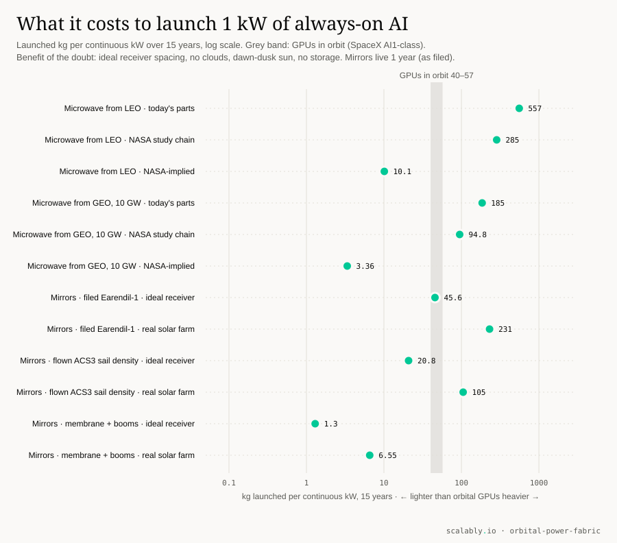
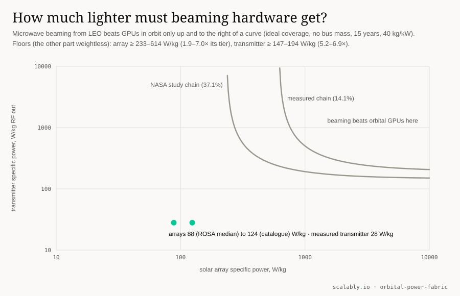

# Move the energy, not the data centre?

## A falsifiable model of orbital energy for AI, and exactly what must change before space wins

*Pavle Lazić, ScalablyAI · report SR-2026-003 · v1.0 · 2026-09-27 · model and code: Apache-2.0 · text, data and figures: CC BY 4.0 · test-chip design files: CERN-OHL-P-2.0 · repository: https://github.com/scalably-io/orbital-power-fabric*

---

## 1. Summary

**Question.** Should space first serve artificial intelligence as an energy layer, beaming power or reflecting sunlight to data centres on Earth, rather than as a compute layer with GPUs in orbit? The case for the energy layer is that GPUs depreciate in a few years while energy infrastructure could last decades, so one should launch only the long-lived part.

**Method.** We built an open model in which every input is a sourced claim with a verbatim quote, a numbered derivation with a test, or a labelled assumption. We fixed the metric and the verdict rules before computing any break-even. Independent reviewers with fresh context, who had not seen our reasoning, then tried to break the model; they were AI models, not human experts (section 3). Their reviews reversed several of our intermediate conclusions; the main reversals are in section 9 and all of them in `docs/NEGATIVE-FINDINGS.md`.

**Answer, with today's hardware and prices.**

1. **Microwave power beaming loses to GPUs in orbit on launched mass, from low orbit and from geostationary orbit, at every non-speculative tier.** The transmitter is the wall. The only measured transmitter specific power in our ledger, from a 2015 ground-test panel, is 28 W of radio-frequency power per kg (R2-043). Beaming from low orbit needs at least 147–194 W/kg even if the solar array weighed nothing. From geostationary orbit, with NASA's study-assumed conversion chain and 10 GW delivered, it needs at least 130 W/kg (4.7 times today); with today's arrays no transmitter is light enough.
2. **Orbital mirrors are lighter than GPUs in orbit only if two favourable conditions hold at once:** the areal density of a flown solar sail (200 g/m², NASA's ACS3, R1-151) and a purpose-built receiving field that turns every watt of mirror light into electricity at full-sun efficiency. Aimed at a real tracking solar farm, which converts about 5.9% of the light landing on its site (R5-077), sail-density mirrors are 105 kg per continuous kW over 15 years against 40–57, and only a bare membrane with no deployer or bus is lighter. Reflect Orbital's filed Earendil-1 system, at its own filed life of about 1 year, is 45.6 kg per kW even onto the ideal receiver with no clouds, inside the range of GPUs in orbit. Any mirror fleet must also hold 0.12–0.24 km² of mirror over each receiving site at once before a ground inverter at a site in darkness produces anything.
3. **At today's launch price, the launch alone of GPUs in orbit, of microwave beaming and of sail-class mirrors costs more than ground solar with storage sized for 97–99.4% of hours** ($120–192 per MWh of AI load); only speculative hardware passes on launch cost, and the last hours on the ground need backup we did not price. Of the options we compared, the ground is the best supported today: solar and storage built on site, with optics used for interconnect.
4. **Photonic matrix engines that stream weights cannot fix large-model inference, and our resident-weight photonic design fails with measured parts.** An engine that streams weights from high-bandwidth memory is capped at 1.9–6.4 times a B300 GPU in memory-bound decode even if its computation were free, depending on the memory's energy per bit. A resident-weight engine with direct photon-to-charge read-out beats a B300 by 10 times only in an idealised case that cannot be built as specified. With measured parts and precision required on real outputs, its whole system may use at most 2.65 times its optical-core energy at NVFP4 pairing, leaving the control, calibration, clocking and I/O electronics less than twice the core, and at FP8 pairing the core alone misses the gate. The architecture is not new; the negative result and its brackets are. Other photonic architectures are not ruled out by this analysis.

**What would change the verdict.** Table 9 lists 12 quantities, each with today's sourced value and the value at which a conclusion flips. Every measured or derived number in the prose is filled in by code from the ledger or the model, and design choices such as layer size are set in the build script: `./scripts/reproduce.sh` and `python3 paper/build_paper.py` rebuild it.



*Figure 1. Launched kg per continuous kW of AI load over 15 years. Grey band: GPUs in orbit. Energy options receive ideal receiver spacing, no clouds, dawn-dusk sunlight and no storage. Mirrors are shown twice: onto an ideal receiver fully covered with PV, and onto a real tracking solar farm.*

## 2. Question and preregistered metric

The unit of comparison is one kilowatt of AI accelerator load (IT power, GB300 NVL72 class) running continuously for L = 10, 15 or 20 years. Four branches supply it:

- **A, GPUs in orbit.** The accelerator flies and is relaunched at the shorter of its refresh cadence and the vehicle life.
- **B, microwave beaming.** Orbital solar arrays feed a microwave transmitter; a ground rectenna feeds GPUs on Earth. Low orbit (B-LEO, 625 km, 30° minimum elevation) and geostationary orbit (B-GEO).
- **C, orbital mirrors.** Mirrors reflect sunlight onto ground solar farms that feed GPUs on Earth.
- **T, the ground.** Solar and storage on Earth. The original handoff compared orbital energy only with orbital compute; any orbital option must also beat the ground.

**Primary metric:** lifecycle launched mass per continuous kW of AI load, counting every replacement as a whole spacecraft. Because the orbital-GPU baseline is a range, "lighter" means below its lower end, "heavier" means above its upper end, and anything between is inside the range. The verdict rules V1 to V4 and the metric were committed in `docs/PREREGISTRATION.md` before any break-even was computed; later changes are dated amendments.

**Tiers, and where they depart from our own rule.** The preregistration defines *current* as flown, qualified or buyable, *next* as best demonstrated and *speculative* as projected, and each B or C tier is compared with the same tier of A. The evidence does not fill every cell that way, so we state what each cell really is:

- A current is a vendor statement for a vehicle that has not flown (R1-005); A has no demonstrated next tier, so A next equals A current.
- B current combines flight and catalogue solar wings (median 88.2 W/kg, R2-093), a ground-tested transmitter (R2-043) and a conversion chain with two measured factors and five study assumptions. B next is a scenario: a catalogue wing and NASA's study-assumed chain, not demonstrated hardware.
- C current is a filing (Earendil-1, R1-112, R1-113). C next uses the density of a flown sail spacecraft, which is flown but is not a mirror. C speculative counts membrane and booms only.

**Choices that favour B and C.** No bus or structure mass for B; receivers spaced so that their visibility caps never overlap (an upper bound on coverage, D03); dawn-dusk sunlight; energy delivered to the receiver network counted as if it served one continuous load (D22); launched mass to geostationary orbit counted like mass to low orbit; no eclipse storage, rectenna exclusion zone or land for geostationary beaming; for mirrors, a receiving field fully covered with PV at its full-sun efficiency of 30% (we also show a real solar farm), zenith atmosphere and full capture. Where B or C lose with these choices, they lose without them.

## 3. Method: an auditable evidence ledger

The ledger `evidence/claims.csv` holds 1,214 claims (373 of them measurements) plus 70 sources we could not access, kept so that nobody repeats the dead end. Each row carries a source URL, a locator (page, table or section), a verbatim quote of at most forty words, a retrieval date and a status: MEASURED, VENDOR-STATED, FILING, STUDY-ASSUMED, DERIVED or PROJECTED. We speak of them differently: a vendor statement is not a measurement, and a study assumption is not a demonstration.

Every formula in the model has a numbered derivation (D01–D22, appendix A) and a test that pins it; guard tests were mutation-checked by deleting the guarded code and confirming the test fails. When a quantity has no source, we either label the assumption (appendix B) or report the value at which the conclusion flips. Some model constants are code literals that carry their claim IDs in comments rather than being read from the ledger at run time.

**How this was made.** Scalably built this work with AI research agents (Anthropic's Claude) that searched primary sources and wrote ledger rows into separate files. Rows were merged only after an automated validator passed, with quotes spot-checked against the downloaded source text for each research batch, not every row (EXPERIMENTS E006…E029, E035). For a derived value the quote gives an input and the row's notes give the derivation. The model and this paper were then reviewed by AI models with fresh context (Anthropic's Claude Opus and OpenAI's Codex), not by human domain experts. We publish it so that people who build this hardware can check it.

To challenge a number, open an issue with the claim ID and a better source. The verdict, the tables and the prose regenerate from the ledger.

## 4. Results

The summary table compares the three energy branches with GPUs in orbit, tier by tier, over 15 years. Every B and C value uses the favourable choices listed in section 2.

*Table 1. Launched kg per continuous kW of AI load over 15 years, with no clouds.*

| tier | GPUs in orbit (A) | microwave, LEO, ideal coverage | microwave, GEO, 10 GW | mirrors, fully covered receiver | mirrors, onto a real solar farm |
|---|---|---|---|---|---|
| current | 40–57 | 557.1 (heavier) | 185.1 (heavier) | 45.6 (inside the range) | 230.7 (heavier) |
| next | 40–57 | 285.3 (heavier) | 94.8 (heavier) | 20.8 (lighter) | 105.3 (heavier) |
| speculative | 30–43 | 10.1 (lighter) | 3.4 (lighter) | 1.3 (lighter) | 6.6 (lighter) |

### 4.1 GPUs in orbit

SpaceX states 75 kW per ton for its Starmind AI1 vehicle (R1-005, vendor-stated). The page does not say whether the numerator is average or peak power, which gives 13.3–19.0 kg per continuous kW per launch; if the ton is a short ton, the lower end is 12.1. Starcloud's Starcloud-3 has been described as 2,000 kg in a filing (R1-073) and, in press accounts, as a two-tonne, 100 kW or a three-tonne, 200 kW spacecraft with the power basis not given (R1-076); each description gives 15–20 kg per kW, consistent with that range. Satellite filings give a 5-year life (R1-023), so 15 years takes 3 launches: 40–57 kg per kW. A filed target of 100 kW per ton (R1-020, projected) sets the speculative tier at 30–43.

### 4.2 Microwave beaming from low orbit

With perfect receiver coverage, beaming costs 557 kg per kW over 15 years with today's parts and 285 with a catalogue array and NASA's study-assumed chain, against 40–57 for GPUs in orbit. Only NASA-implied whole-system hardware (10.1) is lighter. With receivers only on land, the current tier rises to 1,914.

The transmitter decides it. At the measured 28 W/kg (JAXA's 2015 ground-test GaN panel, R2-043; no space-qualified value was found, R2-042), the transmitter alone costs 92 kg per kW per launch, 277 over 15 years, even with weightless solar arrays. The break-even transmitter is 147–194 W/kg (6.9 times today with the chain of today's parts). With today's arrays the arrays alone weigh 278 kg per kW over 15 years, so no transmitter, however light, rescues current-tier beaming.



*Figure 2. Microwave beaming from low orbit beats GPUs in orbit only above and to the right of a curve. The measured transmitter (28 W/kg) and today's arrays (88.2–124.1 W/kg) sit far below both curves.*

The solar array is the second wall. NASA's own space-solar study implies 909–938 W/kg for the whole system (R2-018), about 11 times the 84.6 W/kg of the flown iROSA wing (R2-093). NASA concludes that its baseline is not cost-competitive even if access to space were free (R2-028).

A dawn-dusk orbit keeps the satellites in sunlight, but it also keeps them over the day-night line. An equatorial receiver lies within reach of a dawn-dusk orbital plane for only about 8.8% of the day, in two windows around dawn and dusk (D22), and any single satellite passes overhead for minutes. The receiver network as a whole can take energy continuously, but a continuous load at any one site would need storage or a grid linking sites, which we do not count.

### 4.3 Microwave beaming from geostationary orbit

Geostationary orbit removes the visibility problem: one satellite sees one rectenna almost all the time. It does not remove the transmitter. A panel of given specific power cannot radiate more than that power times its own mass (D20), so a one-kilometre JAXA-class aperture, which already needs a 13.1 km² rectenna, can radiate at most 0.98 GW of radio-frequency power. Delivering 10 GW needs 17.0–22.5 GW radiated, and the transmitter must grow with it.

*Table 2. Microwave beaming from geostationary orbit, transmitter sized by the power it radiates (D20).*

| tier | delivered | RF to radiate | kg per kW per launch | service life needed to match A over 15 y (whole launches) | at the 15-year design life |
|---|---|---|---|---|---|
| current | 1 GW | 2.2 GW | 185.1 | none within the lifecycle | loses |
| current | 10 GW | 22.5 GW | 185.1 | none within the lifecycle | loses |
| next | 1 GW | 1.7 GW | 94.8 | none within the lifecycle | loses |
| next | 10 GW | 17.0 GW | 94.8 | none within the lifecycle | loses |
| speculative | 1 GW | folded into system W/kg | 3.4 | 1.9 y | wins |
| speculative | 10 GW | folded into system W/kg | 3.4 | 1.9 y | wins |

GEO satellites are designed for a median 15 years (R12-022); no power satellite has flown. Counting whole spacecraft, no service life lets current- or next-tier GEO beaming match GPUs in orbit within 15 years: a single launch (94.8–185.1 kg per kW) already exceeds their 15-year total. Only the transmitter can change this (P1). The model is generous to GEO in several ways. It counts mass lifted to geostationary orbit like mass lifted to low orbit, although geostationary orbit takes far more launch energy. It delivers power through the eclipses around the equinoxes with no storage (D04). It keeps the one-kilometre receiving geometry, although a transmitter sized for 10 GW at the measured panel density would be about 4.2–4.8 km across. And it charges nothing for the rectenna site, although 10 GW on 13.1 km² averages about 1,237–1,636 W/m² of microwaves against a general-public exposure limit of 10 W/m² (R2-108), so the site would need an exclusion zone.

### 4.4 Orbital mirrors

A mirror in orbit reflects an image of the Sun, not a beam. At 625 km the image covers about 26.5 km² at zenith (D05), so a single mirror adds almost nothing to the irradiance on the ground. Utility inverters start producing at 2.6 W/m² with an ideal module and about 5 W/m² at half efficiency in low light (R5-069). A receiving site in darkness therefore needs 0.12–0.24 km² of mirror overhead at once, about 384–738 Earendil-1-size mirrors, before any power flows. The mass figures below assume a fleet at that scale. Like beaming, a dawn-dusk mirror serves each site near its own dawn and dusk (D22), which suits extending existing solar farms but not a continuous load at one site.

The only sourced life for an orbital reflector is Earendil-1's filing: about one year of operations and a passive drag deorbit in about five months (R1-115, R1-116). We apply that 1-year life to every tier, because lighter reflectors with more area per kilogram decay faster, and report the life each tier needs.

*Table 3. Orbital mirrors: kg per continuous kW over 15 years with weather, and what each tier needs to match GPUs in orbit.*

| tier | coverage | cloud-free 0.66 | night 0.62 | global 0.33 | same-tier A | cloud-free share needed | mirror life needed (whole launches) |
|---|---|---|---|---|---|---|---|
| current | ideal | 69.1 | 73.6 | 138.2 | 40–57 | cannot win | ≥ 1.88 y |
| current | land-only | 237.5 | 252.8 | 474.9 | 40–57 | cannot win | ≥ 7.50 y |
| next | ideal | 31.5 | 33.6 | 63.1 | 40–57 | ≥ 0.52 | ≥ 0.79 y |
| next | land-only | 108.4 | 115.4 | 216.7 | 40–57 | cannot win | ≥ 3.00 y |
| speculative | ideal | 2.0 | 2.1 | 3.9 | 30–43 | ≥ 0.04 | ≥ 0.07 y |
| speculative | land-only | 6.7 | 7.2 | 13.5 | 30–43 | ≥ 0.15 | ≥ 0.23 y |

The filed Earendil-1 system (142 kg for 324 m², R1-112, R1-113) is 45.6 kg per kW onto the ideal receiver with no clouds, inside the range of GPUs in orbit, and 69.1, above the whole range, with the average cloud cover of solar regions; counting whole launches it would need a life of at least 1.88 years. At the density of the flown ACS3 sail spacecraft (200 g/m², R1-151) mirrors are lighter with ideal coverage and at least 0.52 of the site cloud-free, but not with receivers only on land. ACS3 is a sail, not a mirror: its optical quality as a sunlight relay is undemonstrated. All of these figures assume a receiving field fully covered with PV. A real tracking solar farm holds 59.3 MW of panels per km² at full sun (R5-077), so it turns only about 5.9% of the light landing on its site into electricity; aimed at such a farm, even with no clouds, the filed system is 231 kg per kW, the sail-density mirror 105 and the bare membrane 6.6. Mirrors that beat GPUs in orbit need a dedicated receiver built for them, whose area and cost this paper does not model. The weather factor is one minus the mean cloud amount, the expected share of a site in direct sun: 0.66 over all hours and 0.62 at night across 12 utility-PV regions (R12-016), and about 0.33 worldwide (R10-052). It ignores light passing through thin cloud and the loss when partial cover pushes part of a site below inverter start. Light pollution and debris risk from fleets of this size are outside the metric.

### 4.5 Cost against the ground

The terrestrial comparator is solar with batteries sized for flat output during 97% and 99.4% of hours in Las Vegas: $104 and $167 per MWh delivered (R5-027, R5-028, modelled with 2024 global prices). Per MWh of AI load that is $120–192. The last 2.4% of the year's energy costs about $2,700 per MWh more than the 97% case (R5-028), so full firmness is expensive on the ground too.

*Table 4. Launch cost alone per MWh of AI load (hardware excluded), and the launch price at which each option matches the ground.*

| option | kg per kW per launch | life | launch $ per IT-MWh at $3,600/kg | at $200/kg | break-even $/kg vs $120–192 |
|---|---|---|---|---|---|
| A current (13.3 kg/kW) | 13.33 | 5 y | 1,095.9 | 60.9 | 393–631 |
| B-LEO current | 185.69 | 5 y | 15,262.6 | 847.9 | 28–45 |
| B-LEO speculative | 3.37 | 5 y | 277.0 | 15.4 | 1,554–2,496 |
| B-GEO speculative, 10 GW | 3.36 | 15 y | 92.1 | 5.1 | 4,677–7,510 |
| C next (flown ACS3 density) | 1.39 | 1 y | 570.2 | 31.7 | 755–1,213 |
| C speculative (membrane + booms) | 0.09 | 1 y | 35.5 | 2.0 | 12,130–19,478 |

At today's $3,600/kg (R1-057, a study assumption), launch alone for GPUs in orbit costs $1,096 per MWh of AI load, and the break-even launch price is $393–631/kg with hardware free. At $200/kg, projected for the mid-2030s (R1-053), it falls to $61. If launch were bought at $60/kg, a Starship cost scenario with rapid reuse in Google's Suncatcher study (R1-056, a cost to the launcher, not a customer price), it would be $18.3. At today's price two of the speculative rows pass: NASA-implied geostationary hardware and mirrors of bare membrane and booms.

### 4.6 Sensitivity

Table 5 draws the uncertain inputs across stated ranges and reports the share of draws in which each option is lighter than GPUs in orbit. It is not a probability of success: the ranges span tiers and regions, their shapes are assumptions, and no transmitter above 28 W/kg or array above 124.1 W/kg is sourced, so their upper ends are shown at several values.

*Table 5. Share of draws lighter than GPUs in orbit over 15 years.*

| ranges drawn | microwave, LEO | microwave, GEO 10 GW | mirrors |
|---|---|---|---|
| PV 88→124 W/kg (ROSA median→catalogue), transmitter 28→280 (≤10×), log-uniform | 0.000 | 0.126 | 0.719 |
| same, uniform | 0.000 | 0.227 | 0.385 |
| PV 88→124, transmitter 28→840 (≤30×), log-uniform | 0.000 | 0.246 | 0.719 |
| PV 88→500 (beyond any ROSA wing), transmitter 28→840, log-uniform | 0.012 | 0.578 | 0.719 |
| PV 88→500, transmitter 28→840, uniform | 0.049 | 0.869 | 0.385 |

Low-orbit beaming is lighter in at most 0.049 of draws under the five priors shown. Geostationary beaming moves from 0.13 to 0.87 as the allowed transmitter improves: its verdict is a statement about transmitter specific power. Mirrors range from 0.39 to 0.72, before the site scale of section 4.4 is counted.

## 5. What the evidence supports today

**Energy for AI, on the ground.** Of the options we modelled, near-firm solar with storage on the ground is the cheapest per MWh (R5-027, R5-028). We did not compare it with grid power, gas, wind or nuclear, so we do not claim it is the best ground option. The binding constraint for new capacity is often time: the median utility project built in 2025 took 61 months from interconnection request to operation (R5-042). Off-grid generation on site avoids that queue; a modelled off-grid microgrid meeting 90% of a data centre's load from solar costs $109 per MWh (R5-029) and needs about 102 km² of land per GW of continuous load (R5-031). Coupling on-site PV directly to an 800 VDC rack bus is modelled to deliver 6.8% more energy than AC coupling and 12.4% more than remote PV over the grid (R6-122, excluding battery round-trip losses); that rack architecture is expected in production in 2027 (R6-016).

**Space is not yet the energy layer.** Beaming is transmitter-limited in both orbits, mirrors need sail-class hardware in fleets of hundreds per site, and at today's launch price only speculative hardware passes on launch cost. GPUs in orbit approach ground prices only when launch falls to a few hundred dollars per kilogram (Table 4).

**Photonics' proven energy win today is interconnect.** Photonic arithmetic exists (R3-042) but is not yet more efficient than GPUs at system level (section 6). Co-packaged optics move data at about 5 pJ/bit against 15–20 for pluggable transceivers (R9-030), at rack-to-cluster reach.

## 6. Photonic computing: where light wins and where it cannot

**The memory wall.** Generating one token with a large language model reads every weight once per batch step (D16). High-bandwidth memory costs 11.68 pJ/bit on a measured GH200, including the GPU's control logic (R3-078), and 18.0 pJ/bit through the GPU's caches (R9-005). A photonic engine that streams weights pays the same memory access, because light does not store weights. We bound its best case from above: a B300 draws at most 1,400 W (R3-067) while reading 8 TB/s of memory (R1-100, R1-094), so in memory-bound decode at batch 64 its whole board spends at most 2.73 pJ per multiply-accumulate with 8-bit weights. Even with a free compute core, the photonic engine is capped at 1.9–6.4 times the B300, depending on the memory energy assumed: 1.87 times with GH200 HBM access incl. control, measured (R3-078); 3.81 times with HBM3E incl. IO, study value (R3-082); 6.36 times with HBM3E, SK hynix via secondary citation (R3-081).

*Table 6. Streamed-weight photonic engine (time-integrating read-out) against a B300 at its roofline, with the GH200 memory energy. Photonic support electronics are not included, so every ratio favours photonics.*

| workload | precision pair | photonic core + memory, fJ/MAC | B300 board, fJ/MAC | ratio | cap with a free core |
|---|---|---|---|---|---|
| decode, batch 64 | FP4 (4-bit weights, 5-bit read-out) | 826 | 1,367 | 1.65 | 1.87 |
| prefill, 2,048-token reuse | FP4 (4-bit weights, 5-bit read-out) | 77 | 187 | 2.41 | 8.18 |
| decode, batch 64 | FP8 (8-bit weights, 8-bit read-out) | 1,594 | 2,734 | 1.72 | 1.87 |
| prefill, 2,048-token reuse | FP8 (8-bit weights, 8-bit read-out) | 120 | 560 | 4.69 | 12.27 |

**Support overhead.** The only measured full-stack photonic AI processor runs at 0.81 TOPS/W at system level, and its optical core draws 0.31% of the system power (R3-043, R3-045). That core excludes the laser and the converters. Counted the way we count cores below, with its laser at the 20% wall-plug efficiency we assume for H1' (R8-072), its whole system uses about 10 times its core (43 times if the laser's optical output is counted directly). It is a different architecture at a different precision, so it illustrates the size of support overhead in a real system; it does not bound H1'.

**Sunlight cannot replace the laser.** By the brightness theorem (D18) one spatial mode collects at most 64 nW of sunlight per THz of bandwidth at the telecom wavelength, whatever the collector. That supports far too few precise reads per second for a gigahertz engine; sunlight can feed only slow or massively multimode optics.

**Precision.** A b-bit analog read-out in this paper means fixed-point resolution with shot noise equal to one least-significant bit (D11, D21). That is closer to an INT format than to NVFP4 or FP8, which carry per-block exponents. We pair 5-bit read-out with NVFP4 and 8-bit read-out with FP8; whether either pair gives equal model accuracy is open problem P10, so "matched precision" below means these chosen pairings.

## 7. A testable hypothesis that fails: resident-weight photonic inference

**H1'.** Weights stay in place in non-volatile photonic cells (no hold power, no weight fetch). Each layer is square. Detectors integrate photocurrent directly onto a small capacitive node, with no amplifier (D12): the photon-to-charge conversion is the read-out. Detector-driven modulators pass activations between layers without converters, and the only data converters sit at the input of the first layer and the output of the last.

*Table 7. The idealised case: H1' optical-core energy per multiply-accumulate, 8 layers, precision measured against full scale, a 1 fF node and 20 dB loss, paired with B300 NVFP4 (187 fJ/MAC) and FP8 (560 fJ/MAC) at chip level (R3-070).*

| layer | paired with | read-out | optical core, fJ/MAC | B300 ÷ core | system ÷ core allowed for 10× |
|---|---|---|---|---|---|
| 256 × 256 | NVFP4, 5-bit read-out | conventional receiver | 42.3 | 4.42 | 0.442 |
| 256 × 256 | NVFP4, 5-bit read-out | photon→charge node | 3.63 | 51.5 | 5.15 |
| 1024 × 1024 | NVFP4, 5-bit read-out | conventional receiver | 10.6 | 17.7 | 1.77 |
| 1024 × 1024 | NVFP4, 5-bit read-out | photon→charge node | 0.907 | 206 | 20.6 |
| 256 × 256 | FP8, 8-bit read-out | conventional receiver | 319 | 1.76 | 0.176 |
| 256 × 256 | FP8, 8-bit read-out | photon→charge node | 21.7 | 25.8 | 2.58 |
| 1024 × 1024 | FP8, 8-bit read-out | conventional receiver | 79.7 | 7.02 | 0.702 |
| 1024 × 1024 | FP8, 8-bit read-out | photon→charge node | 5.42 | 103 | 10.3 |

**The idealised case passes on paper but cannot be built as specified.** With photon-to-charge read-out, a 0.91 fJ/MAC core at NVFP4 pairing lets the whole system use up to 20.6 times the core's energy before the 10-fold gain over B300 is lost, and 10.3 times at FP8. With a conventional receiver the allowance is at most 1.8 times the core at any size, which leaves almost nothing for the electronics around it. But a square single-wavelength layer shares its laser light across all outputs only as a lossless unitary (D13): meshes built from measured non-volatile elements lose tens to hundreds of dB (R8-126), and summing many waveguides incoherently onto one single-mode detector collects at most one of them (D13). A real layer would need one wavelength per input or accept those losses.

**Measured parts do not pass.** Table 8 changes one assumption at a time to a sourced value, cumulatively. At NVFP4 pairing three steps each take a large share: the measured-parts detector node (system allowance 20.6 to 12.2 times the core), the O-E-O device's measured input energy of 6.4 fJ per read (R7-046), which sets a floor on the light every output needs (to 5.1 times), and precision over real outputs (to 2.8 times). At FP8 pairing precision dominates. Measured against the largest possible sum of 1,024 terms, as in the idealised case, a typical output spans only a small part of full scale: about 0.17 of one least-significant bit at 5 bits, so it quantises to zero, and about 1.3 at 8 bits. Asking for the same bits over the real output distribution (D21, checked by a photon-counting simulation) makes the photons per multiply-accumulate independent of layer size, which at 8 bits multiplies the light needed many times over.

*Table 8. From the idealised case to measured parts, 1,024 × 1,024, cumulative. Each row is one sourced change.*

| cumulative change (one sourced step each) | NVFP4 pairing: core fJ/MAC | system ÷ core allowed for 10× | FP8 pairing: core fJ/MAC | system ÷ core allowed for 10× |
|---|---|---|---|---|
| idealised H1' (A4): full-scale precision, 1 fF / QE 1 / 1,550 nm node, 20 dB | 0.907 | 20.6 | 5.42 | 10.3 |
| detector node from measured parts (R8-128) | 1.53 | 12.2 | 6.65 | 8.42 |
| O-E-O at its measured operating point (R7-046) | 3.64 | 5.14 | 6.65 | 8.42 |
| precision over the output distribution (D21) | 6.77 | 2.76 | 97.3 | 0.576 |
| buffer before the ADC at the network output (R3-062) | 7.06 | 2.65 | 97.6 | 0.574 |
| and at 26 dB optical loss instead of 20 dB | 25.7 | 0.728 | 384 | 0.146 |
| and at 30 dB optical loss instead of 20 dB | 63.3 | 0.295 | 961 | 0.0582 |

**Verdict.** With today's measured components and our chosen precision pairings, resident-weight photonic inference does not reach a 10-fold energy gain over a B300. At NVFP4 pairing the whole system may use 2.65 times the core's energy, so control, calibration, clocking and I/O get less than twice the core; the only full system measured, a different design, uses about 10 times its core counted the same way. At FP8 pairing its core alone is 98 fJ/MAC, only 5.7 times below a B300 before any support electronics; with 7-bit or 6-bit read-out instead of 8, the system allowance is 2.2 or 7.9 times the core. More than 24.6 dB of optical loss leaves no allowance at all at NVFP4: the core alone would miss the gate. Not modelled, and each would lower the budget further: power to lock ring resonances (R8-103), static power at a stated clock rate, and splitting light to both arms of a balanced pair. The 10-fold gate is the gate we fixed in advance for claiming a large gain (docs/SYNTHESIS.md); the preregistered V4 test, full-system energy below a GB300-class GPU, remains open at both pairings because no full-system measurement exists.

**What would overturn it.** A measured resident-weight layer beating these budgets at the wall plug (P7, P8, P12), or a model evaluation showing that precision defined against full scale is enough for real networks (P10). The favourable definition is supported today only by simulations of small networks, at under one photon per multiply-accumulate (R12-030). Retention of non-volatile photonic weights is reported as test durations from 1,000 seconds (R8-112) to 4 days (R8-099); these are lower bounds, and some cells are extrapolated to years, and the best density we found is an upper bound of 3,183 weights per mm² for ring footprints against 4.76 million for SRAM (R8-104, R8-084). At that density the layer sizes we tested hold 0.5–8.4 million weights on 1.6–26 cm², so even the idealised case concerns small fixed models, and the larger case spans several lithographic reticles.

**Prior art.** The architecture is not new. MIT's US11546077B2 (priority 2021) describes static weights that attenuate photocurrents without consuming power and charge summation, with photodetectors driving modulators for linear summation while converters remain between layers; US10268232B2 (2016) and the University of California's US11144821B2 (2017) cover other combinations, the latter in spiking form (R11-001…019). Built hardware stops at pairs or triples of these elements. What no one has published is the measurement that decides the question: the full-system wall-plug support overhead of such an engine.

### 7.1 The open test chip, OPF-MZI4

A 4×4 Clements mesh of Mach-Zehnder interferometers with titanium-nitride heaters on the CORNERSTONE 220 nm silicon-on-insulator process, assembled from unmodified cells of the MIT-licensed cspdk design kit. It measures grating-coupler loss, heater power per π phase shift, thermal crosstalk, unitary programming and the heater power needed to hold a matrix. It realises unitary matrices only and does not test H1'. Because a power-only measurement cannot certify the complex matrix, the test plan uses an intensity-only fidelity. The layout passes our connectivity check, but the foundry's design-rule check has not been run, because the rules are released only at sign-up. We do not fabricate it ourselves; `chip/TAPEOUT-GUIDE.md` gives routes, prices with claim IDs, the test setup and the measurement order for any lab that wants to.

## 8. Open problems for teams that can build

Each row is a quantity that changes a conclusion of this paper if it moves past the derived target. Rerun `python3 scripts/verdict.py` with the new value to see where the verdict flips. Identifiers such as E021 refer to entries in the repository's experiment log, `EXPERIMENTS.md`.

*Table 9. Open problems, generated by `scripts/open_problems.py`.*

| # | Quantity | Today (source) | Target (derived) | Gap | Evidence |
|---|---|---|---|---|---|
| P1 | Space microwave transmitter specific power (W/kg RF out) | 28 (R2-043, JAXA GaN, measured) | LEO: ≥ 147–194 even with a weightless array; GEO next-tier 10 GW, 15-y life: ≥ 130 | 4.7–6.9× | E021, E028, fig breakeven_bleo |
| P2 | Space solar array specific power (W/kg, array level) | 88 median ROSA-family wing (flight and catalogue); 124 OPAL catalogue wing; large flown class 71–98 (R2-093) | ≥ 233–614 even with a weightless transmitter | 1.9–7.0× (each vs its own tier's array) | E021 |
| P3 | GEO power-satellite service life (years) | 15 y median DESIGN life of GEO comsats (R12-022); no power satellite flown | none: counting whole spacecraft, one current/next-tier launch (1–10 GW, transmitter sized by power, D20) already exceeds orbital GPUs' 15-y total, so no service life suffices; only the transmitter (P1) can change this | n/a | E021, E027, E028, E033 |
| P4 | Orbital-mirror scale per receiving site | Earendil-1: 18×18 m, 142 kg (R1-112/113) | ≥ 0.12–0.24 km² of mirror over each spot at once (≈384–738 Earendil-1s) to clear the 2.6–5 W/m² inverter start (ideal / 50% low-light module) | n/a | E021, E028, R5-069 |
| P5 | Clear-sky fraction at mirror-fed sites | 0.66 all-hours mean, range 0.44–0.84, 12 PV regions (R12-016) | filed Earendil-1 system at its filed 1-y life: cannot win even with ideal coverage (needs > 1.0 clear sky); flown-sail density (ACS3, 200 g/m²) onto a fully covered receiver: ≥ 0.52 ideal coverage, cannot win land-only | n/a | E023, E027, E028 |
| P6 | Launch price for orbital GPUs to match 97–99.4%-firm ground solar (launch cost only, per MWh of AI load) | $3,600/kg (R1-057, STUDY-ASSUMED) | ≤ $393–631/kg (hardware cost excluded) | 5.7–9.2× cheaper | E021 V3 |
| P7 | Photonic full-system support overhead (system ÷ optical core) | 318× (R3-045, Lightmatter Nature 2025) | H1' at 1024², to beat B300 by 10×: system ÷ core ≤ 2.65× with measured parts and precision over real outputs (NVFP4 pairing; FP8 fails at any overhead); ≤ 10.3–20.6× only in the idealised case (full-scale precision, unsourced 1 fF node); 318× is an upper bound (its core excludes laser and ADCs) | ≥ 15× lower (idealised); unattainable at FP8 | E032 ladder (supersedes E028, E025, E018) |
| P8 | Measured wall-plug energy of an integrating + receiverless photonic system | none published (R7) | a measured J/MAC including drivers, control and calibration | n/a | E022, R11 |
| P9 | Non-volatile photonic weight density (weights/mm²) | 5.8–3,183 (R8-104 upper bound; N2 SRAM 4.76 M, R8-084) | ≥ ~10⁵/mm² to hold a 1 B-weight model on ~100 cm²; today H1' holds 0.5–8.4 M weights on 1.6–26 cm² (256²–1024² × 8 layers) | ≥ 30× | E028, R8-124 |
| P10 | Precision equivalence of analog fixed-point read-out | no ledger claim links b-bit analog outputs to NVFP4/FP8 model accuracy | a model run end-to-end on 5-bit fixed-point analog outputs (with measured noise) matching its NVFP4 or FP8 accuracy; note D11's σ = 1 LSB is ≈ b − 1.8 effective bits, and ENOB = b needs 12× the photons | n/a | D11 (E028), fresh-context AI reviews |
| P11 | Orbital reflector service life (years) | ~1 y operations, drag deorbit ~5 months (Earendil-1 filing, R1-115/116) | ≥ 1.88 y (filed Earendil-1 density) / ≥ 0.79 y (flown-sail density) to match orbital GPUs, whole launches, all-hours cloud-free share, ideal coverage | 1.9× | E028, E033 |
| P12 | Optical loss of a 1024 × 1024 resident-weight layer, laser to detector (dB) | 20 dB assumed (R3-037, PROJECTED); no measured layer at this size | ≤ 24.6 dB for H1' (NVFP4 pairing, measured parts) for the whole system to stay within the 10× gate at all (system ÷ core ≥ 1); +6 dB over 20 dB leaves 0.73× | n/a | E032, E033 |

## 9. Negative results, including our own errors

Negative results are deliverables. The full list, with evidence classes, is `docs/NEGATIVE-FINDINGS.md`. The most consequential:

- **The original handoff omitted the ground as a comparator.** Every orbital option must beat solar and storage on Earth, not only orbital compute.
- **Space-to-ground power beaming has so far been shown as detection, not usable power.** Caltech's MAPLE beam was detected on the roof of its campus (R2-052), up to 20 dB above the ground station's noise floor (R2-057); its best in-orbit microwave transfer measured 3.37–3.66% DC to DC over about 30 cm inside one spacecraft (R2-053). Caltech's own estimate of today's sunlight-to-grid efficiency from geostationary orbit is 2.77% (R2-065), and NASA's baseline costs $0.61–1.59 per kWh (R2-023).
- **Our geostationary "win" was a modelling error.** An earlier version of our verdict kept the transmitter at one kilometre for any power and showed next-tier beaming winning at 10 GW. Sized by the power it must radiate, a single launch already outweighs GPUs in orbit over 15 years (reviewer finding, E028).
- **We gave Reflect's mirror five years it does not have.** We had borrowed the life of data-centre satellites. The mirror's own filing states about one year, and at that life it is not lighter than GPUs in orbit (E028).
- **We counted GPU memory energy twice.** B300's energy per operation is its total board power divided by peak throughput, which already includes memory; we had added memory energy on top. The corrected bound is in section 6 (E028).
- **We used fractional spacecraft for break-even lives.** Counting whole launches, the filed mirror needs 1.88 years, not less, and no life rescues geostationary beaming within the lifecycle (E033).
- **We let mirror light convert at full efficiency on every lit square metre.** A real solar farm covers only part of its land with panels; aimed at one, no mirror we could source is lighter than GPUs in orbit except a bare membrane (E034).
- **Our photonic hypothesis failed three times.** Time-integrating read-out needs a new weight every cycle, so it cannot combine with resident weights (E025). Our next design shared laser light across more inputs than outputs, which power conservation forbids in a single-wavelength network (E028). The design that survived both, H1', fails once built from measured parts (E031, E032; section 7).

## 10. Limitations, and the strongest case against our conclusions

**Limitations.** Cost comparisons count launch only; spacecraft hardware would widen every gap. The orbital-GPU baseline rests on vendor statements for vehicles that have not flown. The 5-year life of beaming satellites is borrowed from data-centre filings. Receiver coverage is an upper bound, the land-only case is an approximation, and continuous per-site supply is not modelled (D22). Mirror optics are assumed perfect. The photonic results are optical-core budgets at an assumed optical loss, precision equivalence is unshown, and resonance-locking and static power are not modelled. Laser power beaming is not modelled: the only in-orbit laser demonstration in our ledger delivered about 1.5 W at about 11% over 1.45 m inside one payload (R2-072), which is not yet a space-to-ground data point. No human domain expert has reviewed this work yet.

**The strongest case against us.**

- *Launch will become cheap.* That changes the cost comparison, not the mass ranking. Current-tier microwave beaming matches the ground on launch cost only below $28–45/kg (Table 4), below the customer price projected in Google's Suncatcher study but within reach of that study's cost scenarios for heavily reused Starships (R1-056). Beaming remains heavier than GPUs in orbit at every non-speculative tier.
- *Transmitters will improve.* That is the one lever that matters for beaming, and we give its target: 130 W/kg for next-tier geostationary beaming (P1). No such space transmitter is in the ledger.
- *Mirrors are not meant to power a continuous load.* Their business case is extending existing solar farms into dawn and dusk, which is also where a dawn-dusk orbit serves each site (D22), and onto such farms they convert only a few percent of their light (section 4.4). Our metric follows the handoff's question, continuous AI load, and so does not value shifting energy in time. A fair test compares a mirror-delivered MWh at dawn with a battery-shifted MWh, and we leave it open.
- *GPUs in orbit are a moving target too.* The filed goal of 100 kW per ton would lower A to 30–43 kg per kW, raising every bar in this paper.

## 11. Reproduce and contribute

```
git clone https://github.com/scalably-io/orbital-power-fabric && cd orbital-power-fabric
python3 -m pip install numpy scipy matplotlib pytest
./scripts/reproduce.sh          # validates the ledger, runs the tests, regenerates verdict, tables, figures and this paper
python3 paper/build_paper.py    # regenerates this paper; fails on any typed number or unknown citation
```

To change an assumption, edit it in `opf/scenarios.py` (each value carries its claim ID) and rerun. To correct a claim, open an issue with the claim ID, the better source, its locator and a verbatim quote. Code is Apache-2.0, text, data and figures are CC BY 4.0, and the chip design files are CERN-OHL-P-2.0.

## Appendix A. Derivations

Each derivation in `docs/DERIVATIONS.md` gives a statement, the derivation, its assumptions, the code that implements it and the test that pins it.

| ID | derivation |
|---|---|
| D01 | Slant range at elevation e |
| D02 | Visibility cap and time fraction |
| D03 | Receiver fabric coverage |
| D04 | Eclipse fraction, circular orbit, beta angle β |
| D05 | Image of the Sun after a flat mirror |
| D06 | Oblique ground footprint |
| D07 | Mirror tilt |
| D08 | Airmass |
| D09 | Diffraction and aperture-to-aperture collection |
| D10 | Radiator floor |
| D11 | Shot-noise photon floor for b-bit read-out |
| D12 | Direct photon→charge read-out (no amplifier) |
| D13 | Per-MAC energy of an N × N optical matrix engine |
| D14 | Thermo-optic weight hold energy per MAC is independent of N |
| D15 | Clements mesh |
| D16 | Transformer decode operator counts |
| D17 | Launched mass per continuous kW of AI load |
| D18 | Brightness theorem: sunlight power per spatial mode |
| D19 | Streamed-weight energy per MAC |
| D20 | GEO transmitter mass: power-limited or aperture-limited, whichever is larger |
| D21 | Photons for b bits over the output distribution (balanced incoherent read-out) |
| D22 | Per-site service in a dawn-dusk orbit |

## Appendix B. Parameter registry

Values used by the model with their sources (`opf/params.py`). "Assumption" marks a value with no source, stated as such.

| parameter | value | unit | source |
|---|---|---|---|
| `solar_constant` | 1360.8 | W/m2 | R2-119 |
| `sun_angle` | 0.5331 | deg | R12-032 |
| `land_fraction` | 0.291 | - | R12-019 |
| `clear_sky_fraction` | 0.66 | - | R12-016 |
| `geo_design_life_years` | 15 | y | R12-022 |
| `rack_kw` | 142 | kW | R1-095 |
| `pue` | 1.15 | - | assumption: illustrative (a typical liquid-cooled data centre); not swept in v1.0 |
| `pv_eff` | 0.35 | - | R2-001 |
| `dc_dc_space` | 0.9 | - | R2-002 |
| `dc_rf` | 0.7 | - | R2-003 |
| `antenna` | 0.9 | - | R2-004 |
| `atmosphere_rf` | 0.98 | - | R2-005 |
| `beam_capture` | 0.95 | - | R2-006 |
| `rectenna` | 0.78 | - | R2-007 |
| `dc_dc_ground` | 0.9 | - | R2-008 |
| `pv_w_per_kg_flown` | 84.6 | W/kg | R2-093 |
| `pv_w_per_kg_today_caltech` | 25 | W/kg | R2-067 |
| `reflector_altitude` | 625000 | m | assumption: handoff altitude, swept |
| `mirror_reflectivity` | 0.9 | - | assumption: no sourced value yet |
| `atm_clear_zenith` | 0.64 | - | R1-136 |
| `ground_pv_eff` | 0.3 | - | assumption: full-sun value; low light is lower (R5) |
| `membrane_areal_density` | 0.00425 | kg/m2 | R1-149 |
| `inverter_start_irradiance` | 2.6 | W/m2 | R5-069 |
| `radiator_emissivity` | 0.9 | - | assumption: typical coating |
| `radiator_temp` | 350 | K | assumption: handoff value; AI1 needs >=322 K two-sided (R1-014) |
| `orbital_compute_kw_per_tonne` | 75 | kW/t | R1-005 |
| `satellite_life_years` | 5 | y | R1-023 |
| `server_life_years` | 5.5 | y | R1-035 |
